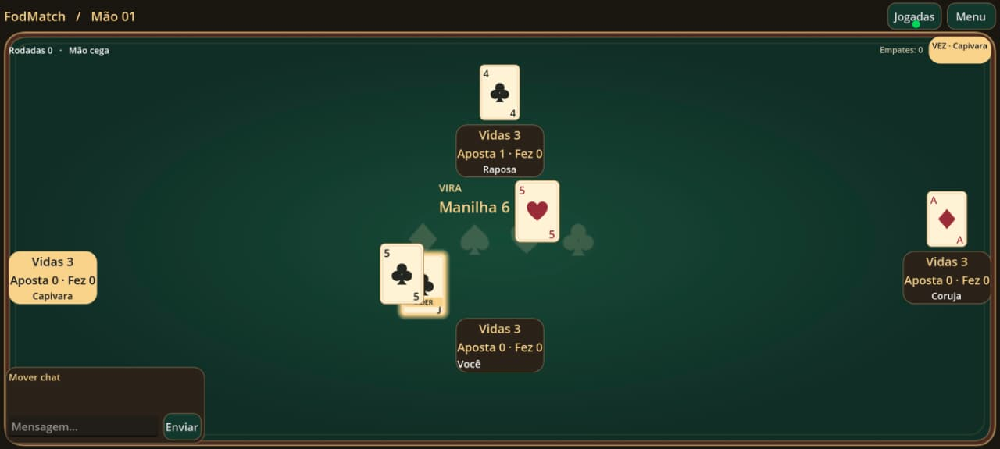
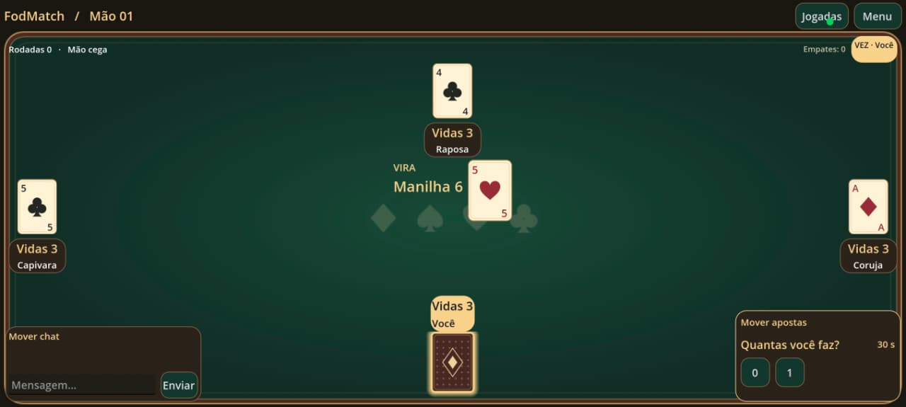
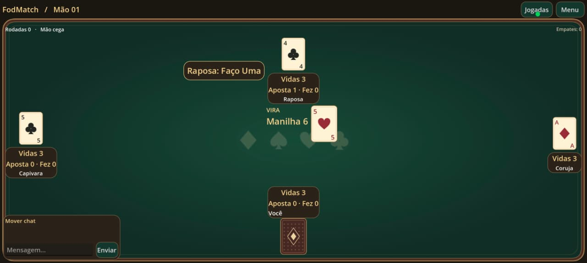
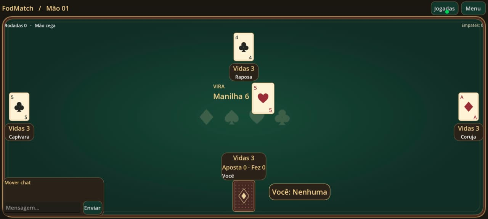
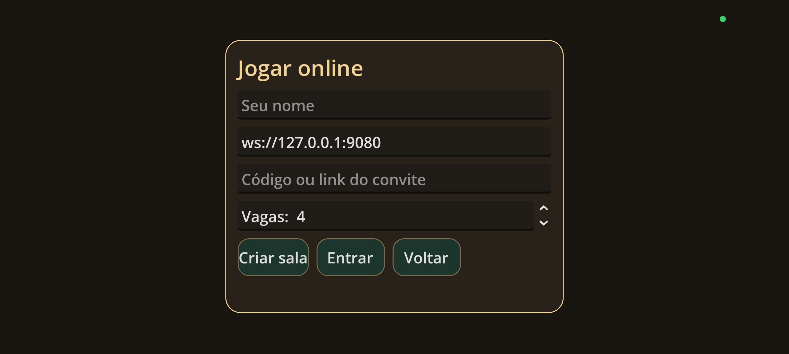
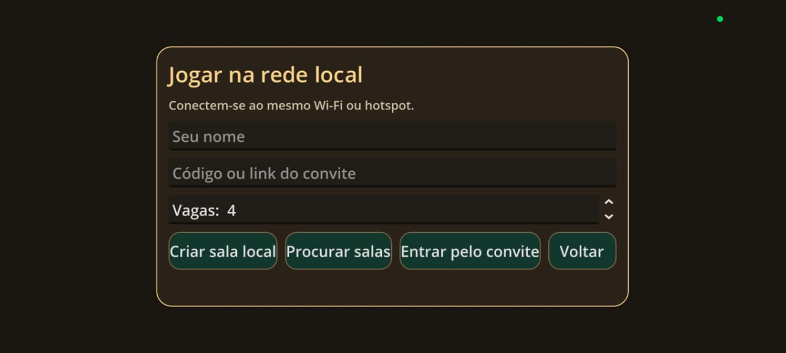

# Fala, galera! 👋

Criei o **FodMatch**, um jogo de cartas inspirado no **Fodinha**, pra jogar com o pessoal do trabalho. Curti tanto o resultado que resolvi compartilhar. Se quiser testar, fica à vontade!

🎮 **[Jogar FodMatch no navegador](https://fodmatch.onrender.com/)**

Dá pra jogar contra bots ou criar uma sala e chamar os amigos. O jogo foi feito com **Godot** e **GDScript** e também tem versão pra Android.

## Dá uma olhada no jogo

| | |
| --- | --- |
|  |  |
|  |  |
|  |  |
